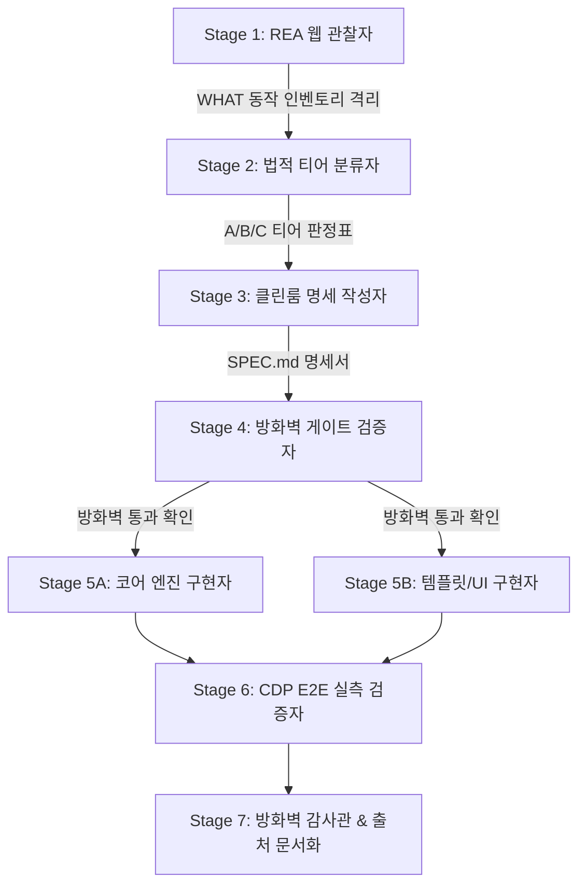

# Cleanroom Spec Recreation Pipeline

## 개요
외부 상용 웹 애플리케이션(예: Canva, Notion, Figma 등)의 UI/UX 및 핵심 인터랙션을 안전하게 분석(Reverse-Engineering)하고, 원본 소스코드나 독점 에셋의 리터럴 유입(0줄) 없이 **순수 독자 코드(Cleanroom)**로 동등한 웹앱 MVP를 재창조하는 7단계 표준 엔지니어링 파이프라인입니다.

---

## 7단계 파이프라인 구조

---

## 단계별 핵심 규칙 & 안전 지침

### Stage 1: REA 관찰 (Observation & Quarantine)
* **산출물 경로**: `_quarantine/` 격리 폴더에만 저장 (구현자 접근 절대 금지)
* **안티봇(Anti-Bot / Cloudflare) 조기 감지**:
  * 대상 페이지 접속 시 URL이 `challenges.cloudflare.com`이거나 제목이 `잠시만 기다리십시오…` / `Just a moment`인 경우, **단순 로딩 지연으로 오판하여 대기 루프를 돌지 않는다.**
  * 즉시 **사용자의 기존 로그인 브라우저(실크롬 CDP 포트)** 연결을 시도하거나 수동 인증 통과를 요청한다.
* **관찰 대상 (WHAT만 기록)**:
  * 레이어 좌표계, 4점 리사이즈, 중심축 회전 등 상호작용 불변식
  * 메뉴바, 사이드탭 구성 및 상태 전이 규칙
  * ⚠️ 원본 JS/CSS 코드, 원본 헥스 색상, 로고 이미지, 카피 문구는 수집 및 기록 절대 금지.

### Stage 2: 티어 판정 (Tier Classification)
* **A (Public / Open Source)**: MIT/Apache 라이브러리 패턴 → 출처 표기 후 채택
* **B (General Pattern / Math)**: 캔버스 변환, 리사이즈 핸들, z-order, Undo 스택, 직렬화 → 자유 재구현
* **C (Proprietary Creative)**: 고유 브랜드 아트, 독점 색상군, 폰트 → 추상화된 범위(범용 값)로 대체

### Stage 3: 클린룸 명세서 (SPEC.md) 작성
* 템플릿:
  1. GOAL & 사용자 가치
  2. 인터페이스 및 데이터 모델 (레이어 객체 규격)
  3. 캔버스 조작 모델 (회전축, 리사이즈 핸들 4점, 선택 테두리)
  4. 상태 영속성 (Cross-reload LocalStorage 저장)
  5. 갤러리 및 템플릿 API (`window.GalleryAPI`)
  6. NON-GOALS (MVP 밖의 무거운 기능 배제)
  7. Acceptance Criteria (수용 기준)

### Stage 4: 방화벽 게이트 (Firewall Gate)
* `_gate_scan.py` 자동 스크립트를 작성하여 `SPEC.md`에 원본 브랜드명, 리터럴 코드 흔적이 0건인지 검증.
* 통과 시 `FIREWALL_GATE.md` 작성 후 구현 단계 승인.

### Stage 5: 병렬 클린룸 구현 (Parallel Implementation)
* 구현자는 `_quarantine/` 폴더 및 원본 사이트 열람 불가. 오직 `SPEC.md` 텍스트만 참조.
* **팀 분업 (2인 병렬)**:
  * **에디터 구현자 (`impl_editor`)**: `index.html`, `styles.css`, `editor.js` (순수 바닐라 HTML5 캔버스 엔진)
  * **템플릿 구현자 (`impl_gallery`)**: `templates.js` (순수 도형+텍스트 기반 벡터 템플릿 5종 이상)
* **자체 팔레트 사용**: 원본 브랜드색 대신 독자 팔레트(`ink`, `cream`, `espresso`, `mint` 등) 적용.

### Stage 6: 독립 CDP E2E 검증 (Authentic Browser Testing)
* 로컬 웹서버 실행: `python -m http.server 18765`
* 독립 CDP 드라이버(`cdp_driver.js`) 구동:
  * 실제 마우스 드래그 & 드롭 좌표 일치 검증
  * 회전된 레이어의 리사이즈 시 중심축 앵커 오차 검증
  * 새로고침(F5) 후 로컬 스토리지 레이어 자동 복원 검증
  * 캔버스 픽셀 색상 실측(100+ 색상) 및 고해상도 PNG 익스포트 검증
* 검증 결과는 `VERIFICATION_REPORT.md`에 기록.

### Stage 7: 최종 방화벽 감사 & 출처 문서화 (Audit & Provenance)
* `_audit_scan.py`: 구현 산출물 전수 스캔 (독립 브랜드 단어 외 참조 브랜드 0건 확인)
* `PROVENANCE.md`: 각 단계 참여 에이전트, 타임라인, SHA-256 해시값 기록.
* `README.md`: 프로젝트 개요 및 로컬 실행 방법 작성.
